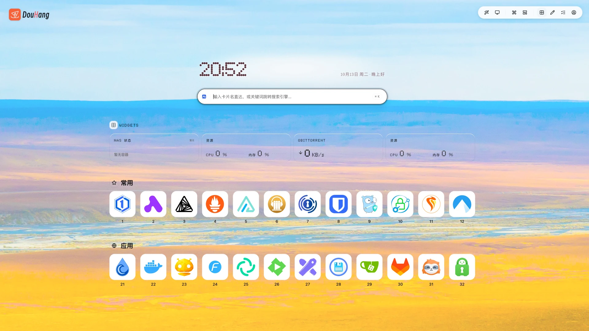

<div align="center">

<a href="https://github.com/wangyan/douhang"></a>

# 斗航（DouHang）

### 面向局域网与私有云的自托管网址导航站

以卡片网格组织服务入口，支持分类归档、拖拽排序与内外网址自动切换<br>
提供资源监控、在线状态探测、拼音搜索与小组件面板<br>
设访客与管理员双模式，访客可本地自定义外观

[](https://github.com/wangyan/douhang/releases/latest)
[](https://github.com/wangyan/douhang/releases)
[](https://github.com/wangyan/douhang/stargazers)
[](https://github.com/wangyan/douhang/actions/workflows/docker-publish.yml)
[](LICENSE)

<a href="https://github.com/wangyan/douhang"></a>

</div>

## 核心功能

- **卡片化导航**：按分类组织服务卡片，支持分类与卡片拖拽排序、批量删除、在线状态灯
- **网址自切换**：按网络策略（自动探测 / 固定内网 / 固定外网）跳转到可达地址
- **Widget 栏**：容器状态、系统资源水位、下载监控、倒数日 / 正数日，每个实例独立配置尺寸
- **支持快捷键**：`⌘ / Ctrl + K` 唤起，支持子串、全拼与拼音首字母缩写匹配
- **壁纸与图标**：内置壁纸与图标库，支持上传自定义壁纸与图标、favicon 自动抓取
- **备份与恢复**：一键导出配置数据与上传文件，支持导入恢复到任意实例
- **新版本提醒**：检测到新版本时右下角提示，可关闭自动检测或随时手动检查
- **单用户认证**：Credentials + JWT，30 天有效期
- **现代浏览器支持**：建议 Chromium 123+、Safari 17.5+ 或 Firefox 128+，内置低版本拦截探针与离线引导页

## 技术栈

- **框架与运行时**：Next.js 16（App Router + Turbopack）/ React 19 / TypeScript / Node.js 24
- **界面与设计系统**：Astryx 组件库 + Tailwind CSS v4
- **数据库与 ORM**：SQLite + Prisma 7（libsql driver adapter）
- **认证体系**：NextAuth v5（Credentials + JWT）+ bcryptjs
- **布局与交互**：dnd-kit（卡片与分类排序）+ react-grid-layout（Widget 网格布局）
- **容器状态监控**：Docker Engine API 直连（unix socket）

详细技术栈与版本选型详见[架构文档](./docs/ARCHITECTURE.md)。

## 浏览器支持

建议使用以下内核或更高版本访问：

| 浏览器内核 | 建议版本 | 覆盖产品 |
|---|---|---|
| **Chromium** | **123+** | Chrome、Edge、Brave 及主流双核浏览器极速模式 |
| **Safari** | **17.5+** | macOS / iOS / iPadOS Safari |
| **Firefox** | **128+** | Firefox 及 ESR 长期支持版 |

项目内置低版本拦截探针，内核未达到要求时自动跳转至离线引导页（`/outdated.html`），支持下载离线安装包或跳过提示直接访问。

## 快速部署

推荐使用镜像方式部署，默认拉取官方 GitHub Packages 公开镜像 `ghcr.io/wangyan/douhang:latest`（若网络受限亦可使用官方 Docker Hub 镜像 `idiswy/douhang:latest`），无需克隆源码。完整部署方式详见[部署指南](./docs/DEPLOYMENT.md)。

**前置条件**：已安装 Docker 与 Docker Compose v2，且主机可访问互联网以下载镜像。

```bash
mkdir douhang && cd douhang

# 1. 获取生产编排文件
curl -O https://raw.githubusercontent.com/wangyan/douhang/main/docker-compose.prod.yml

# 2. 生成 .env（仅在 .env 不存在时创建）
if [ ! -f .env ]; then
  {
    echo "AUTH_SECRET=$(openssl rand -base64 32)"
    echo "AUTH_USERNAME=admin"
    echo "AUTH_PASSWORD=$(openssl rand -base64 18)"
  } > .env
  echo "已生成随机登录口令，见 .env 中的 AUTH_PASSWORD，请妥善保存"
fi

# 3. 启动
docker compose -f docker-compose.prod.yml up -d
```

打开 `http://<主机IP>:3000`，使用 `.env` 中的账号登录。**登录后请立即前往「设置 → 账号与安全」修改密码**；修改密码后所有既有会话立即失效，需要重新登录。

数据持久化在 `./data` 目录，容器启动时会自动完成数据库迁移与种子写入。

## 本地开发

针对二次开发与代码贡献，可在宿主机直接搭建基于 Node.js 24 的本地开发环境：

```bash
# 1. 克隆代码仓库并安装依赖
git clone https://github.com/wangyan/douhang.git
cd douhang
npm ci

# 2. 准备环境变量
cp .env.example .env

# 3. 初始化本地 SQLite 数据库与种子数据
npm run db:generate
npm run db:migrate:dev
npm run db:seed

# 4. 启动开发服务器（Turbopack 热重载）
npm run dev
```

启动后在浏览器访问 `http://localhost:3000` 即可开始调试。

在提交改动前，请运行以下命令进行代码规范与类型校验：

```bash
npm run check       # 执行 Biome 静态检查与格式化
npm run typecheck   # 执行 TypeScript 严格类型检查
```

完整环境变量说明、源码构建与故障排查详见[部署指南](./docs/DEPLOYMENT.md#3-本地开发环境搭建)。

## 贡献指南

项目版本号采用 `主版本号.次版本号.修订号`（`MAJOR.MINOR.PATCH`）格式，代码提交遵循 [Conventional Commits](https://www.conventionalcommits.org/) 规范。

| 档位 | 对应版本位 | 适用场景 | 示例 |
|---|---|---|---|
| `patch` | 修订号 | 缺陷修复、内部重构、样式对齐、工具链升级等不改变既有用户能力的变更 | 修复排版错位、微调色值、内部依赖升级 |
| `minor` | 次版本号 | 向下兼容的新增用户能力（如新增小组件、新增偏好选项等） | 新增 qBittorrent 监控、新增素材管理面板 |
| `major` | 主版本号 | 破坏性架构变更（部署架构重大变更、数据模型或接口不向下兼容） | 数据库底层重构、配置体系不兼容升级 |

完整代码提交格式、凭据配置与发版异常恢复详见[贡献指南](./docs/CONTRIBUTING.md)。

## 文档

| 文档 | 面向 | 内容 |
|---|---|---|
| [用户指南](./docs/USER_GUIDE.md) | 访问者/用户 | 前台浏览、服务访问、内外网智能切换、全局搜索、外观调节与 PWA 体验 |
| [管理指南](./docs/ADMIN_GUIDE.md) | 管理员 | 卡片与分类维护、Widget 监控配置、全局后台设置、素材管理与备份恢复 |
| [部署指南](./docs/DEPLOYMENT.md) | 部署者 | 镜像与源码部署、本地开发、环境变量、反向代理、升级、故障排查 |
| [架构文档](./docs/ARCHITECTURE.md) | 维护者 | 技术栈、目录结构与分层、核心机制、数据模型、质量工具与权威来源 |
| [贡献指南](./docs/CONTRIBUTING.md) | 贡献者 | 提交信息写法、变更日志规范、发布流程 |

## 致谢

本项目基于开源项目 **[NavDeck](https://github.com/wavesbig/navdeck)** 进行二次开发与重构。

## 社区

感谢 [LINUX DO](https://linux.do/) 社区提供开放、友善的技术交流平台。

<a href="https://star-history.com/#wangyan/douhang&Date">
  <picture>
    <source media="(prefers-color-scheme: dark)" srcset="https://api.star-history.com/svg?repos=wangyan/douhang&type=Date&theme=dark">
    
  </picture>
</a>

## 许可证

[MIT](LICENSE)